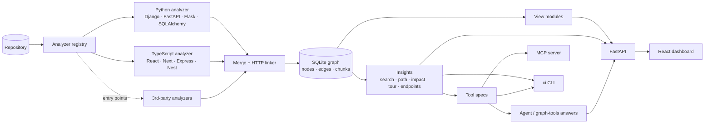

# Architecture

This implements [plan.md](../plan.md): a framework-agnostic analysis core, language and framework analyzers as plugins, one knowledge graph, and three front doors (web dashboard, CLI, MCP) that share the same grounded queries.



## Pipeline

1. **Discover**: `ci_parsers.list_source_files` walks the repo once, for the union of all analyzer extensions. It honours `.ciignore` and skips vendored, build and generated files.
2. **Analyze**: each registered analyzer whose `detect()` matches runs on its own files (`ci_indexer.analyzers`). One analyzer failing is logged as a warning and doesn't stop the others.
   - **Python**: AST symbols, imports and calls; Django settings, URLs, models, signals and middleware; FastAPI, Flask and ninja decorator routes, with `include_router` and `register_blueprint` prefixes; `Depends` → `INJECTS`; SQLAlchemy and SQLModel tables, columns, `ForeignKey` → `FK_TO`, and `session.get/select/add/delete` → reads and writes. Import roots include `src/` layouts and `pyproject.toml` dirs, so monorepos resolve.
   - **TypeScript/JavaScript** (tree-sitter):
     - functions, classes, object-literal API clients, React components and hooks
     - imports via relative paths, tsconfig `paths`, `@/`, workspace packages, re-exports and CommonJS
     - calls (including `this.injected.method()`), JSX → `RENDERS`, React Router and Next pages
     - routes from Express (with mount prefixes and middleware), NestJS (with guards) and Next API routes
     - outbound HTTP calls
3. **Merge and link** (`ci_core.analysis`): results are unioned and the Project node is merged. Then `link_http_calls` matches each request path against every Endpoint:
   - framework parameter syntaxes are normalized, and the literal-segment score breaks ties
   - a proxy prefix such as `/api` may be dropped, at lower confidence
   - remaining ties go to the endpoint sharing the most directories with the caller (the same service in a monorepo)
   - matched calls become `HTTP_CALLS` edges, and absolute URLs to other hosts become `ExternalService` nodes
4. **Store**: the graph is rewritten atomically. Chunks are re-embedded only for touched files. Fingerprints (content plus structural hash per file, plus the combined analyzer version) decide between SKIP, PARTIAL, ARCHITECTURE and FULL.
5. **Serve**: the API, CLI and MCP read the same store. `GraphStore.load_index()` caches the parsed graph in-process until the DB file changes, and engines are cached per database. A **per-project index lock** in `run_index_job` is also process-local — run a **single worker** for API/CLI (see README deployment).

## Graph model

- **Nodes:** Project, Package, Module, Class, Function, Component, Endpoint, Middleware, Model, Table, Field, Migration, ExternalService, ConfigRef.
- **Edges:** CONTAINS, IMPORTS, CALLS, ROUTES_TO, HANDLES, READS_MODEL, WRITES_MODEL, FK_TO, QUERIES, DEPENDS_ON (with `relation`: uses / inherits / middleware / guard / http / admin), SUBSCRIBES, MIDDLEWARE, RENDERS, HTTP_CALLS, INJECTS.
- Every node and edge carries `extractor`, `confidence` and source location. Nodes also carry `role`, `layer`, `complexity`, `summary`, `tags` and `language`. Endpoints carry `route`, `methods` and `framework`.
- Dependency edges (`insights.DEPENDENCY_EDGES`) include RENDERS, HTTP_CALLS and INJECTS. Impact analysis therefore crosses stacks: changing a backend model reaches the endpoint, the API client, and the React component that renders the data.

## View modules (`ci_core.views`)

Each diagram is a `ViewModule` in its own file. It declares its id, label, icon and group; `requires` (node types that make it available); `best_for` (node types it should open for, which drives navigation); and whether it is `focusable`. The UI renders whatever `/projects/{ref}/views` returns (`ref` = id, name, or path).

| Module | Shows | Focus |
|--------|-------|-------|
| `explore` | Packages → modules → symbols with expand/collapse and lifted dependency edges | – |
| `layers` | Modules, routes, models and services by layer | – |
| `architecture` | Packages with weighted dependency roll-ups | – |
| `api-flow` | Route → handler → services → models/external, plus client callers | Endpoint: full UI → DB trace |
| `call-graph` | Callers and callees (CALLS, INJECTS, SUBSCRIBES, HTTP_CALLS) | Any symbol |
| `components` | Render tree, hooks, stores, API clients and the endpoints they call | Subtree of a component |
| `er` | Models with folded fields and FKs | Model: which code reads/writes it |
| `integrations` | External services and their users | One service |

## AI layer

- `ci_ai.toolspec`: one list of JSON-schema'd tools over `GraphTools`, used by the agent, the MCP server and the CLI. Results are size-capped and secret-redacted.
- `ci_ai.agent`: when `ALLOW_LLM` is set and an LLM is configured, a streaming tool-calling loop runs through LiteLLM (up to 6 steps, with tool use disabled on the last). Answers cite `[Name](node:<id>)` and `[path:line](source:path#Lline)`. Citations are gathered from the tool results, with cited ones ranked first. Without an LLM, or if the LLM fails, deterministic graph tools produce the same event stream and link format.
- `ci_ai.llm`: `LLM_MODEL`, `LLM_API_KEY` and `LLM_API_BASE` (self-hosted, OpenAI-compatible) are passed explicitly.
- Hash embeddings are a local stand-in. Swapping in a real embedding model needs no schema change.

## Security defaults

- Source stays local. LLM calls require `ALLOW_LLM=true` plus a key or base URL. Every prompt, history turn and tool result is redacted for secrets, and requests are logged (`llm_requests`).
- Source access is limited to an allowlist of indexed files and protected against path traversal (API, tools, MCP).
- CORS is limited to localhost dev origins, without credentials. The combined `ci serve --ui` app serves the dashboard and API from one origin. In **`CI_MODE=server`**, clients must send `CI_API_KEY`; the bundled dashboard does not, so put the UI behind your own auth proxy or use local mode / API-only.
- Remote ingest accepts **public GitHub URLs only** (no tokens). Clone failures become a failed index job; `POST /projects/analyze` returns **500** with the error message, which the ingest form displays.
- LLM text is never rendered as raw HTML. Markdown links only allow http(s) and mailto, plus the app's `node:` and `source:` schemes.

## Extending

**Add an analyzer** (a new language or framework) as its own package:

```python
# my_ci_go/__init__.py
from ci_core.analysis import AnalysisResult, HttpCall

class GoAnalyzer:
    id, name, version, extensions = "go", "Go (net/http, gin)", "1", (".go",)
    def detect(self, root, files): return bool(files)
    def analyze(self, project_id, root, files) -> AnalysisResult:
        # emit NodeRecord/EdgeRecord with stable ids (ci_parsers.stable_node_id),
        # Endpoint nodes with properties {"route", "methods", "framework"},
        # and HttpCall(...) for outbound requests: the core links them.
        ...

ANALYZER = GoAnalyzer()
```

```toml
[project.entry-points."codebase_intelligence.analyzers"]
go = "my_ci_go:ANALYZER"
```

Reuse the shared vocabulary (`NodeType`, `EdgeType`, the layers in `ci_core.layers`, and roles such as `views`, `models`, `components`). Every insight, view, tool and the UI then work without changes.

**Add a diagram:** create a module that calls `register_view(ViewModule(...))`, and either import it in `ci_core/views/__init__.py` or expose it through the `codebase_intelligence.views` entry-point group.

## Limitations

- On API startup, `fail_orphaned_running_jobs()` marks stale `RUNNING` jobs as failed after a crash (single-process assumption).
- Static analysis only. Reflection, dynamic routing, runtime DI containers, and URLs built from runtime config can be missed. Inferred edges have confidence below 0.7 and are drawn dashed.
- Call resolution is name- and import-based, not type-checked: there is no Pyright or tsserver integration yet.
- Frontend → backend matching works on paths. A base URL taken from env/config is skipped when it is a leading template substitution; otherwise it is not resolved.
- GraphQL, gRPC, message-queue topics, Java/Spring and PHP/Laravel are not analyzed yet. Each would be a new analyzer package.
