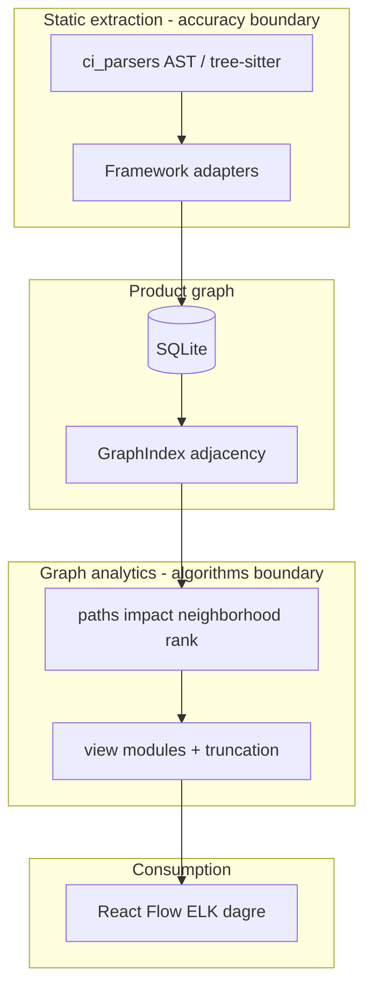
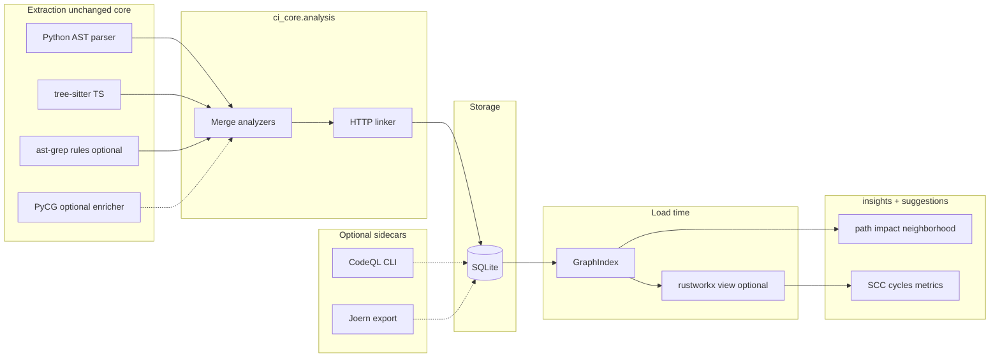

# Graph Analysis Architecture — Research & Roadmap

Research-phase deliverable (November 2026). Assesses the parser → index → `GraphIndex` → insights pipeline, compares graph-algorithm and static-analysis technologies, and proposes a P0/P1/P2 roadmap. **Implementation is gated on success criteria in §8.**

Related: [architecture.md](architecture.md) · [onboarding.md](onboarding.md) · [competitive-notes.md](competitive-notes.md)

**Scope:** Backend graph model (`NodeRecord` / `EdgeRecord`, SQLite via [`GraphStore`](../backend/packages/core/src/ci_core/db.py)), analytics in [`GraphIndex`](../backend/packages/core/src/ci_core/insights.py), pluggable analyzers, TypeScript via tree-sitter.

---

## 1. Current architecture assessment

### What to keep (working and aligned with product)

| Layer | Location | Role |
|--------|----------|------|
| Domain graph model | `ci_core.models`, product-specific `EdgeType` / `NodeType` | Not replaceable with a generic graph DB without losing semantics (CONTAINS vs CALLS, framework metadata, `confidence`, `layer`) |
| Pluggable analyzers | `ci_indexer.analyzers`, entry points | Correct extension point for Python/Django/TS; matches [architecture.md](architecture.md#extending) |
| Merge + HTTP linker | `ci_core.analysis.link_http_calls` | **Unique product value** (UI → API → model); not provided by generic graph libs |
| View modules | `ci_core.views.*` | Presentation graphs derived from `GraphIndex`, not raw storage |
| Incremental index | [`ci_indexer/changes.py`](../backend/packages/indexer/src/ci_indexer/changes.py), fingerprints | SKIP / PARTIAL / ARCHITECTURE / FULL is appropriate; elastic Datalog incremental is overkill for file-granular rebuilds today |
| Storage | SQLite per project | Fits local-first; graphs are typically **10³–10⁵** nodes post-view-truncation (e.g. Layers `MAX_NODES=220` in [`views/_common.py`](../backend/packages/core/src/ci_core/views/_common.py)) |
| Analytics API surface | `find_path`, `compute_impact`, `neighborhood_subgraph`, `search_nodes` in `insights.py` | Pure functions over `GraphIndex`; good test boundary |

### What limits us

| Limitation | Evidence in repo |
|------------|------------------|
| **Static extraction only** | Analyzers emit edges from AST/patterns; no runtime |
| **Shallow call resolution** | No assignment-graph / points-to; known dynamic patterns partially handled in adapters, not universally |
| **No data-flow** | Edges are structural dependencies, not taint/def-use |
| **Limited cycle/SCC analysis** | **Addressed (P0):** [`graph_algo.py`](../backend/packages/core/src/ci_core/graph_algo.py) + import SCC in `suggestions` (`__init__` barrels, `TYPE_CHECKING`, and lazy function imports excluded from the cycle subgraph). Not yet in path/impact or dedicated UI. |
| **Manual BFS** | `find_path`, impact, neighborhood use `deque` + adjacency lists (`insights.py`) |
| **Scalability** | Every request `load_index()` builds full in-memory index (cached per DB mtime); fine for single-worker; costly if graph → millions of edges before view filters |

### Critical distinction

**NetworkX (or similar) does not fix static extraction.** It only upgrades graph analytics (and optional materialization after load).

---

## 2. Technology comparison

Legends: **Fit** = Low / Med / High integration with the current Python monorepo. Benchmarks are indicative from public sources (not re-run on Codebase Intelligence graphs).

### A. Graph algorithms and in-memory analytics

| Technology | Maintained | License | Typical vs NetworkX on large graphs | Capabilities we lack | Fit | Verdict |
|------------|------------|---------|-------------------------------------|----------------------|-----|---------|
| **Current (`dict` + BFS)** | — | — | Baseline; O(V+E) paths fine for product graphs | SCC, multi-source, betweenness, validated shortest-path APIs | — | Keep core; add library behind thin adapter |
| [NetworkX](https://networkx.org/) 3.4+ | Active | BSD-3 | Pure Python; slow on 10⁵+ edges for centrality ([graph-tool benchmarks](https://graph-tool.skewed.de/performance.html)) | Rich algorithms, well-tested | **High** | **Complement** for non-hot paths (SCC, cycles, diagnostics) |
| [rustworkx](https://www.rustworkx.org/) 0.16+ | Active | Apache-2.0 | Often much faster than NetworkX on medium graphs (Rust core) | Same class as NetworkX | **Med** (Rust wheel dep) | **Preferred** if algorithm CPU becomes hot on full index |
| [igraph](https://igraph.org/) 1.0+ | Active | GPL-2.0 | ~10× faster than NetworkX on many algos ([PMC 2025](https://pmc.ncbi.nlm.nih.gov/articles/PMC13436765/)) | Fast SCC, components, layout | **Med** | **Defer** unless GPL is acceptable for distribution |
| [graph-tool](https://graph-tool.skewed.de/) | Active | GPL-3.0 | 40–250× vs NetworkX on some benchmarks | Performance king | **Low** (GPL, Boost deps) | **Skip** for product embedding |
| [nx-cugraph](https://docs.nvidia.com/cugraph/) | NVIDIA | Apache-2.0 | Large wins on centrality/BFS at 10⁶+ edges | GPU batch analytics | **Low** | **Skip** unless GPU ops exist |
| Neo4j / Memgraph | Active | Various | Query language for persistent graphs | OLAP on huge graphs, multi-tenant | **Low** | **Skip**; SQLite + in-memory index matches local-first |

### B. Static analysis and call-graph depth (accuracy boundary)

| Technology | Maintained | License | Languages | Call / data-flow | Fit | Verdict |
|------------|------------|---------|-----------|------------------|-----|---------|
| **Current AST + adapters** | — | — | Py, TS/JS | Framework-specific, heuristic `confidence` | — | Keep as primary |
| [tree-sitter](https://tree-sitter.github.io/) (in use) | Active | MIT | Many grammars | Syntax only | **High** | **Keep**; extend grammars, not replace |
| [ast-grep](https://ast-grep.github.io/) | Active | MIT | tree-sitter langs | Structural rules; **no** data-flow ([comparison](https://ast-grep.github.io/advanced/tool-comparison)) | **Med** | **Complement** for adapter rules + CI policy checks |
| [PyCG](https://github.com/vitsalis/PyCG) / [pycg-rs](https://nwyin.github.io/pycg-rs/) | Active / maintained | Check repo | Python | Assignment-based call graph | **Med–High** | **Study for P1** — merge candidate CALLS with confidence |
| [Joern](https://joern.io/) | Active | Apache-2.0 | JVM CPG pipeline | Interprocedural data-flow ([2024](https://joern.io/blog/interproc-dataflow-2024/)) | **Low** | **Optional sidecar** for security deep-dives |
| [CodeQL](https://codeql.github.com/) | Active | Custom (queries OSS) | Many | Security data-flow | **Low** | **Ad hoc only** — separate DB, CLI ([Python DB](https://docs.github.com/en/code-security/tutorials/customize-code-scanning/prepare-code-for-analysis)) |
| [Soufflé](https://souffle-lang.github.io/) | Active | UPL | Datalog analyses | Whole-program if modeled; elastic incremental ([PPDP'21](https://souffle-lang.github.io/ppdp21.html), not mainline) | **Low** | **P2 research** |
| Semgrep / Opengrep | Active | LGPL-2.1 | Many | Syntax + taint modes | **Med** | **Complement** for security rules export |

### C. Incremental computation

| Approach | Status | Relevance |
|----------|--------|-----------|
| File fingerprints + partial re-index (current) | Production | **Keep**; primary incremental story |
| Soufflé elastic incremental | Research branch | Only if analyses move to Datalog |
| Joern/CodeQL incremental | Product-specific | Heavy ops; poor fit local-first |

### D. Visualization (frontend)

| Tech | Verdict |
|------|---------|
| dagre, ELK, React Flow (current) | **Keep**; aligned with nested Explore |
| Cytoscape.js, yFiles, sigma.js | **Skip** unless abandoning React Flow |

---

## 3. Recommended technology stack

**Principle:** One graph-library adapter inside `ci_core`, no SQLite schema change; deepen **extractors** separately.

| Layer | Recommendation | Justification |
|-------|----------------|---------------|
| Extraction | tree-sitter (TS) + `ast` (Py) + **ast-grep** for repeatable structural rules | Cheap accuracy wins without CPG |
| Call-graph enrichment (Python) | Prototype **PyCG** (or pycg-rs CLI) → supplemental `CALLS` with `confidence < 1` | Polymorphism/higher-order gaps without Joern |
| Graph analytics | **rustworkx** first, fallback **networkx** via `ci_core.graph_algo` facade | Apache-2.0; speed if analytics run on full graph |
| Storage | SQLite + `GraphIndex` | No graph DB |
| Deep security / data-flow | Optional CodeQL or Joern export (“advanced analysis” job) | User-triggered, not default index |
| Embeddings / search | fastembed or similar (P2; see architecture.md) | Orthogonal to graph algorithms |
| UI | React Flow + ELK | No change |

**Non-goals:** graph-tool/igraph (GPL) as embedded deps; CIS-style speculative edit daemon; replacing the pipeline with a CodeQL database; mandatory GPU analytics.

---

## 4. Gap analysis → addressing technology

| Gap | Best approach | Replace or complement? |
|-----|---------------|-------------------------|
| Dynamic imports / reflection | Heuristics + PyCG-style assignment graph (Py); import graph + literal call targets (TS) | Complement adapters |
| Polymorphism / dispatch | Lower-confidence CALLS edges; optional type stub index later | Complement |
| Cross-file data-flow | Not full taint in v1; lift endpoint→model READS/WRITES + HTTP_CALLS (already strong) | Complement; Joern/CodeQL optional |
| Cycle detection | SCC on import-only or `DEPENDENCY_EDGES` subgraph via rustworkx | Complement insights/suggestions |
| Path algorithms | Keep BFS for product paths; library for validated shortest path if weights added | Complement |
| Scalability | View truncation; lazy adjacency; cache `/summary` | Architecture tweak |
| Incremental graph updates | File-level re-index; in-memory delta only if sub-second patch required | Complement pipeline |
| Multi-language | New adapter packages; not a single Joern spine | Keep plugin model |

---

## 5. Prioritized roadmap (after approval)

### P0 — High value, low risk (1–2 weeks)

| Item | Problem | Approach | Modules | Effort | Risk |
|------|---------|----------|---------|--------|------|
| Graph algorithm facade | Duplicated BFS; no SCC | `ci_core/graph_algo.py`: `DEPENDENCY_EDGES` subgraph → SCC, cycle listing | `insights.py`, `suggestions.py` | Low | Low |
| Import-cycle + hub metrics | suggestions.py only checks pairs | SCC for n>2 cycles; expose in `suggest` + API | `suggestions.py` | Low | Low |
| ast-grep rule pack | Fragile regex in adapters | Rules for FastAPI/Django/axios patterns + fixtures | `adapters/*`, `rules/` | Med | Low |
| Call-graph confidence | Users trust all edges equally | Legend + down-rank low confidence in path/impact | `flow.ts`, `insights.py` | Low | None |
| Benchmark harness | No scale data | Time `load_index`, `find_path`, impact, neighborhood | `backend/scripts/` | Low | None |

### P1 — Capability depth (4–8 weeks)

| Item | Problem | Approach | Modules | Effort | Risk |
|------|---------|----------|---------|--------|------|
| PyCG merge experiment | Missed Python calls | Optional PyCG → map to node IDs → merge CALLS, capped | `ci_indexer/pipeline.py` | Med | Medium precision |
| Assignment tracking (Python) | `func = other; func()` | Intraprocedural def-use in `python_parser` | `ci_parsers/python_parser.py` | Med | Medium |
| TS call resolution | `this.method`, re-exports | Extended tree-sitter symbol table | `ci_adapters_typescript` | High | Medium |
| Subgraph materialization | Full graph in memory | Edge-type filter on load; optional rustworkx backend | `db.py`, `insights.py` | Med | Low |
| Optional CodeQL export | Enterprise security asks | `ci analyze --with-codeql` one-way import | `ci_integrations` (new) | High | Ops + license |

### P2 — Advanced / product-triggered

| Item | Problem | Approach | Effort |
|------|---------|----------|--------|
| Real embeddings + hybrid search | Weak semantic search | fastembed / sentence-transformers | Med |
| Domain/process view | Business narrative | LLM over endpoints/jobs → tags | Med |
| Soufflé micro-analyses | Reusable analyses | Isolated `.dl` for taint subset | High |
| Go/Java analyzers | Client repos | New entry-point packages | High each |
| Shared graph cache (multi-worker) | Horizontal scale | Redis or mmap snapshot | High |
| Speculative edit graph (CIS-like) | Agent writes | Out of scope unless product pivots | — |

---

## 6. Target architecture (with recommended complements)

---

## 7. Official references (research sources)

| Topic | URL |
|-------|-----|
| NetworkX | https://networkx.org/documentation/stable/ |
| rustworkx | https://www.rustworkx.org/ |
| graph-tool performance | https://graph-tool.skewed.de/performance.html |
| igraph 1.0 | https://pmc.ncbi.nlm.nih.gov/articles/PMC13436765/ |
| NVIDIA cuGraph / nx-cugraph | https://docs.nvidia.com/cugraph/ |
| tree-sitter | https://tree-sitter.github.io/ |
| ast-grep comparison | https://ast-grep.github.io/advanced/tool-comparison |
| PyCG paper | https://arxiv.org/abs/2103.00587 |
| Joern interprocedural data-flow | https://joern.io/blog/interproc-dataflow-2024/ |
| CodeQL Python database | https://docs.github.com/en/code-security/tutorials/customize-code-scanning/prepare-code-for-analysis |
| Soufflé elastic incremental (paper) | https://souffle-lang.github.io/ppdp21.html |
| Static analysis landscape (survey) | https://main--gianfree-notes.netlify.app/docs/cybersecurity/static-analysis-tooling-landscape/ |

Log implementation choices in [DECISIONS.md](DECISIONS.md) when P0 work starts.

---

## 8. Success criteria before P0 coding

1. Run benchmark harness on largest internal project (e.g. Understand-Anything fixture + one large Codal repo with `CI_GITHUB_TOKEN`).
2. Legal review: **rustworkx**, **networkx**, optional **PyCG** in distribution.
3. Product sign-off: graph-library work is **analytics-only**; extractor improvements are separate epics.
