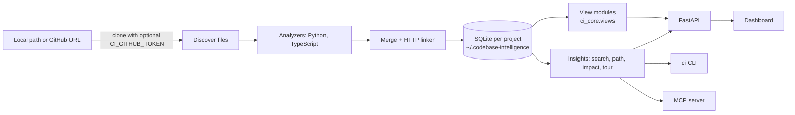

# Developer onboarding

Start here. This page covers what exists, how data flows, and what is integrated vs. planned. Deeper detail is in [architecture.md](architecture.md).

| Doc | Read it for |
|---|---|
| [onboarding.md](onboarding.md) (this) | Stack, data flow, run locally, view catalog, integration status |
| [architecture.md](architecture.md) | Pipeline internals, graph model, extending with analyzers/views |
| [private-repos.md](private-repos.md) | Indexing private GitHub repos with a token |
| [review-2026-11.md](review-2026-11.md) | Latest audit: what's met, partial, missing |
| [audit-report.md](audit-report.md) | Fixture validation and earlier backlog |
| [competitive-notes.md](competitive-notes.md) | How we compare to Understand Anything, the nu demo and CIS; adopt/defer/skip; backlog |
| [../integrations/README.md](../integrations/README.md) | Install into Claude Code (plugin + skill) or Cursor (MCP + rule) |

## Stack

| Part | Tech | Where |
|---|---|---|
| Backend | Python 3.12, uv workspace, FastAPI, Typer, SQLite (SQLAlchemy), tree-sitter, LiteLLM (optional) | `backend/` |
| Frontend | Vite, React, TypeScript, `@xyflow/react` (React Flow), dagre and ELK layouts, vitest | `frontend/` |
| Agents | MCP server over stdio (`ci mcp`) | `backend/apps/mcp` |

## Data flow



1. **Ingest:** `create_project_from_path` / `create_project_from_git` (`ci_indexer.pipeline`) register a project. Git URLs are shallow-cloned to `$CI_DATA_DIR/sources/`.
2. **Index:** `run_index_job` runs every matching analyzer, links frontend HTTP calls to backend endpoints, and writes nodes, edges and chunks to the project's SQLite DB. Incremental runs skip unchanged files.
3. **Query:** the API, CLI and MCP all read the same store. Graph views are built on request by view modules; Explore is computed from the expanded-node set.
4. **Render:** the dashboard fetches `/projects/{ref}/graph/{view}`, lays it out in the browser (dagre for flat views, ELK for nested Explore) and fetches node detail and source for the Inspector.

## Run locally

```bash
cd backend && uv sync --all-packages --group dev
uv run ci analyze /path/to/repo        # or a GitHub URL
uv run ci serve                        # API on :8000 (restart after backend changes; no auto-reload)
cd ../frontend && npm install && npm run dev   # UI on :5173, proxies to the API
```

Gates before a PR:

```bash
cd backend && uv run pytest -q && uv run ruff check .
cd frontend && npm test && npm run build
```

## View catalog

All views support select → highlight neighbours and dim the rest, Inspector detail, and deep links (`#/p=<project>&v=<view>&n=<node>`).

| View | Shows | Layout | Notes |
|---|---|---|---|
| Explore | Packages → modules → symbols, expand in place, lifted edges | ELK nested groups | Chevron expands, double-click zooms, breadcrumbs, collapse-to-level, edge drill-down (`/graph/edges`) |
| Layers | Modules, routes, models, services in layer columns | Lane grid | Capped to the 220 most-connected nodes (banner shown) |
| Architecture | Packages with weighted dependency roll-ups | dagre LR | |
| API flow | Route → handler → services → models; focus an endpoint for UI → DB | dagre LR | Cards show summaries as helper text |
| Jobs | Celery/Dramatiq/RQ tasks, APScheduler, fastapi-utils `repeat_every`, Django management commands, NestJS `@Cron/@Interval`, Bull `@Process` → functions → models written | dagre LR | Schedule shown on the card; available only when jobs exist |
| Call graph | Callers and callees | dagre LR + wide-rank wrap | |
| Components | React render tree, hooks, API clients | dagre LR + wide-rank wrap | |
| Data model (`er`) | Models, fields, FKs | dagre | |
| Integrations | External services and their users | dagre | |

## Configuration

All env vars are validated in `ci_core.settings`; the full list with defaults is in [`.env.example`](../.env.example).

| Variable | Purpose |
|---|---|
| `CI_MODE` | `local` (default) or `server` (requires `CI_API_KEY` and `CI_PROJECT_ROOTS`; disables git URL ingest) |
| `CI_API_KEY`, `CI_PROJECT_ROOTS` | Server-mode auth and path allowlist |
| `CI_GITHUB_TOKEN` (fallback `GITHUB_TOKEN`) | Clone private GitHub repos ([private-repos.md](private-repos.md)) |
| `CI_DATA_DIR` | Where DBs and clones live |
| `CI_CORS_ORIGINS`, `CI_ANALYZERS`, `CI_LOG_LEVEL`, `CI_LOG_JSON` | Runtime tuning |
| `ALLOW_LLM`, `LLM_MODEL`, `LLM_API_KEY`, `LLM_API_BASE` | Optional LLM assistant |

## Integration status

✅ done · ⚠️ partial · ❌ missing · – not applicable

| Feature | Backend | Frontend | CLI | MCP | Tests | What's left |
|---|---|---|---|---|---|---|
| Index local path | ✅ | ✅ | ✅ | ✅ | ✅ | |
| Index public GitHub URL | ✅ | ✅ | ✅ | ❌ | ✅ | MCP `index_project` takes a path only |
| Index private GitHub URL | ✅ token via env | ⚠️ server-side token only | ✅ | ❌ | ✅ unit | Not exercised against a real private repo yet (no access) |
| Incremental index, freshness | ✅ | ✅ | ✅ | ✅ | ✅ | |
| Flat views (layers, architecture, api-flow, call-graph, components, er, integrations) | ✅ | ✅ | – | – | ✅ | |
| Explore (expand, lifted edges, budget) | ✅ | ✅ | ❌ | ❌ | ✅ | No CLI/MCP equivalent |
| Neighbourhood / edge drill-down | ✅ | ✅ | ❌ | ⚠️ `get_callers`/`get_callees` | ✅ | |
| Selection highlight | – | ✅ all views | – | – | ✅ vitest | |
| Search, path, tour, impact | ✅ | ✅ | ✅ | ✅ | ✅ | |
| Background / scheduled jobs | ✅ | ✅ Jobs view | ✅ `ci jobs` | ✅ `list_jobs` | ✅ | Celery beat dicts, `scheduler.add_job(...)` calls and node-cron aren't detected yet |
| Optimization suggestions | ✅ | ❌ no panel yet | ✅ `ci suggest` | ✅ `suggest_optimizations` | ✅ | Heuristic; no performance (N+1, missing index) rules yet |
| Diagrams written into the repo (Mermaid) | ✅ `/docs` | – | ✅ `ci docs` | ✅ `generate_docs` | ✅ | |
| Claude Code plugin / Cursor rule | – | – | – | ✅ | ✅ `claude plugin validate` | Not published to a shared marketplace |
| Endpoints / trace / models | ✅ | ✅ | ✅ | ✅ | ✅ | |
| Assistant (graph tools; LLM optional) | ✅ | ✅ | ✅ `ci ask` | ✅ same tools | ✅ | |
| Source view (allowlisted, traversal-safe) | ✅ | ✅ | – | ✅ | ✅ | |
| Server-mode auth (API key) | ✅ | ❌ UI sends no key | – | – | ✅ | Needs an auth proxy or UI key support |
| Deep links | – | ⚠️ | – | – | ⚠️ | Editing the hash in an open tab doesn't navigate (no `hashchange` listener) |
