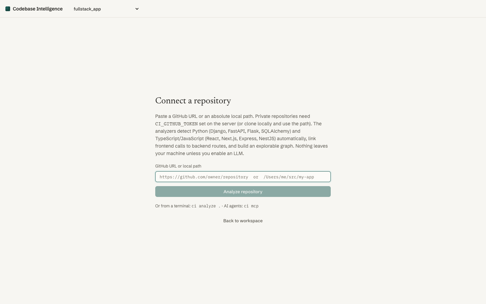
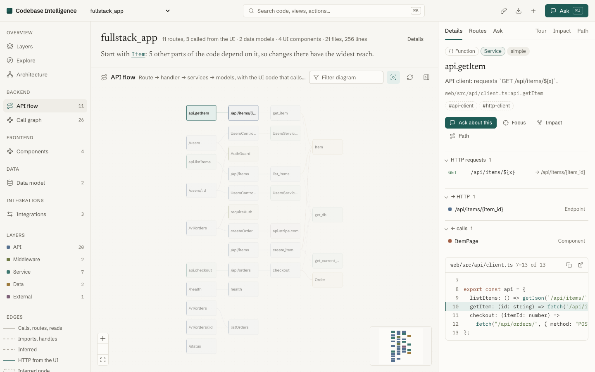
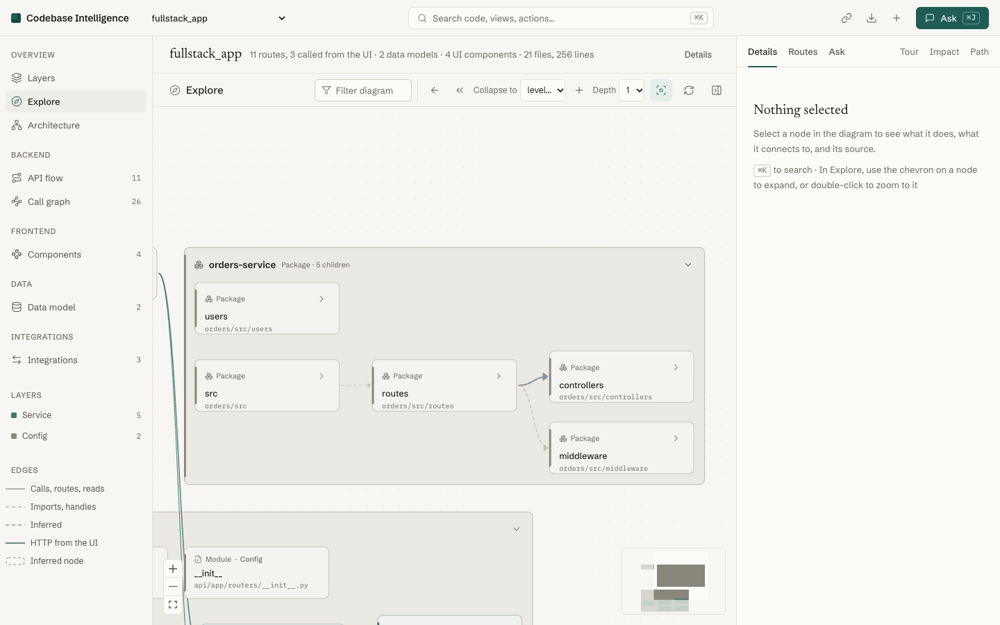
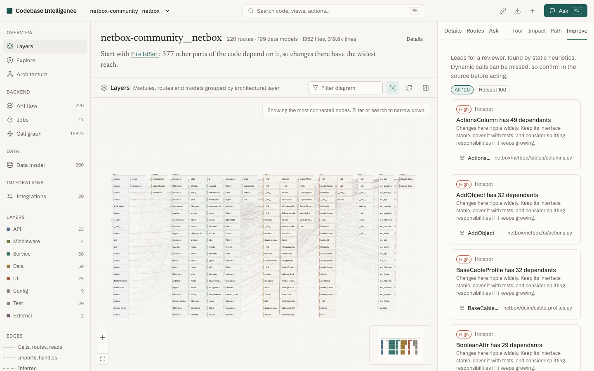
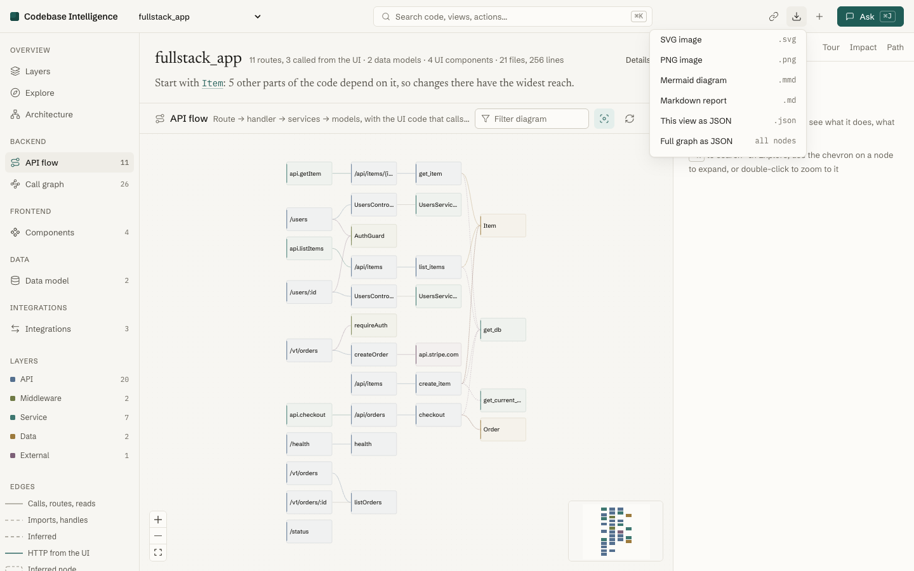
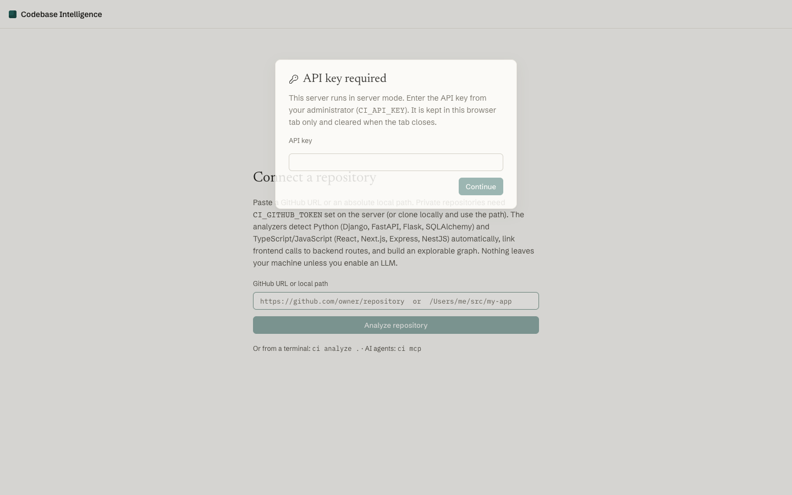

# User guide

For people reading a codebase in the dashboard. Setup is in the [README](../README.md#quickstart). Screenshots are in [`ui-review/after/`](ui-review/after/): the fullstack fixture, and NetBox (18.7k nodes) as a large repo.

## 1. Add a repository

Click **+** (top bar), then paste a GitHub URL or an absolute local path, then **Analyze**.

- GitHub URLs are checked as you type (*Reachable · default branch …*), and *Analyze* stays disabled until access works.
- Private repos need `CI_GITHUB_TOKEN` on the server ([private-repos.md](private-repos.md)).
- Clone and index failures appear under the field with the reason.

## 2. Find your way around

| Area | What it does |
|---|---|
| Sidebar | Diagrams available for this project, with counts. The **Layers** list doubles as a filter (click to hide or show a layer). **Edges** explains line styles. |
| Overview | Project name, key numbers, and where to start. *Details* expands the summary (compact automatically in Explore). |
| Toolbar | View title, **Filter diagram**, Explore controls, **Focus mode** (fade unrelated nodes), reload, show or hide the details pane. |
| Canvas | Two-finger scroll pans; pinch (or ⌘/Ctrl + wheel) zooms. Minimap and zoom controls bottom-left and bottom-right. |
| Details pane | **Details** (selected node or edge), **Routes**, **Ask**, plus **Tour**, **Impact**, **Path** and **Improve**. Drag its edge to resize; ⌘\\ toggles it. |

**Reading a card:**
- the type icon and type name, plus its layer (API, Service, Data…)
- a soft tint in the layer's colour
- *N in* = how many things depend on it
- dashed outline and *inferred* = found by heuristics, so check the source

Zoomed out, cards show names only so they stay readable; zoom in for full cards.

## 3. Explore a large codebase

**Explore** starts at top-level packages.

- Click the **chevron** to expand a package in place; its children appear inside it. Click again to collapse.
- **Double-click** zooms to a node.
- **Breadcrumbs** (top-left of the canvas) show where the selection sits; click one to collapse back to that level.
- **←** undoes the last expand. **«** resets to the top. **Collapse to** jumps to a level.
- **+** expands the selected node. **Depth** sets how far the neighbourhood highlight reaches.
- Click an **edge** to see what it aggregates (for example *calls ×12*) and the underlying relations.
- Selecting a package lists its children in Details.

## 4. Search and keyboard

| Key | Action |
|---|---|
| ⌘K or `/` | Search code, views and actions |
| ⌘J | Ask |
| ⌘\\ | Toggle the details pane |
| Tab, Enter | Move focus between graph nodes; Enter opens the focused node |
| Esc | Clear impact, path or highlight overlays; close menus |

## 5. Ask, Tour, Impact, Path, Improve

- **Ask:** questions about the code. Answers cite nodes (click to jump) and `file:line` (opens the source). Works without an LLM (graph tools only). With `ALLOW_LLM=1` it uses your configured model.
- **Tour:** a guided reading order from entry points to data.
- **Impact:** what a change to the selected node, or to your uncommitted changes, could affect, coloured by hops.
- **Path:** the shortest dependency path between two nodes.
- **Improve:** refactoring and reuse leads from static heuristics:
  - hotspots (many dependants)
  - large functions
  - helpers duplicated across files
  - models written from many places
  - import cycles
  - possibly unused functions

  Filter by kind; click a node to open it. Each kind gets a share of the list, so on large repos hotspots don't crowd out the rest. These are leads, not verdicts: dynamic calls can be missed.

## 6. Share and export

- **Copy link** (chain icon): the URL keeps project, view, selection and Explore expansion. Pasting it into an open tab navigates there.
- **Export** (download icon) for the current view:

  | Format | Use it for |
  |---|---|
  | SVG, PNG | Slides, tickets |
  | Mermaid | GitHub, GitLab, Notion |
  | Markdown | Diagram plus node and relation tables, for PRs and wikis |
  | JSON | This view |
  | Full graph as JSON | Everything |

  All are generated in the browser.

## 7. Stale data

When files have changed since the last index, a banner offers **Re-index** (incremental) and **Impact of changes**.

## 8. Shared server (server mode)

If your admin runs `CI_MODE=server`, the dashboard asks for the API key once per browser tab. It is kept for that tab only.

## Selecting and tracing

Click a node to select it: 2px accent border, accent fill and a ring. Direct dependants are marked **in** (amber) and dependencies **out** (blue). The **Trace** bar (top right) switches direction (In / Both / Out) and depth (1–10 hops or all hops); hop counts show on the badges. Unrelated nodes fade but come back on hover. Esc, or a click on the empty canvas, clears the selection. Edge labels appear on hover and on traced edges.

## Explore levels

**Open level…** opens the whole tree to a level. With a package selected, it opens levels inside that package instead. **Collapse…** folds everything below a level. On very large repos a whole level may not fit in one drawing; the busiest packages open first and a note says so.

## API flow

Pick a route in the list (filter by text or HTTP method). The canvas shows only that request, left to right: UI callers → endpoint → guards/dependencies → handler → services → data access → models/external services. Dashed, labelled links are inferred.

## Managing projects

Use the project name in the top bar → **Manage projects**. From there you can search, sort, **Re-index changed** (fast) or **Full re-index**, rename, edit ignore patterns, turn on auto-refresh, or remove a project. Removing deletes this tool's index (and a clone it made for a GitHub URL), never your source folder; the dialog lists exactly what goes. **Activity** is the audit log; **Status** shows mode, analyzers and running jobs. The bookmark icon saves the current view (diagram, selection, expansions).

## Keeping the dashboard current after `git pull`

The index is a snapshot, so new code needs a re-index. Any one of these keeps it current:

1. **Git hooks (recommended):** run `ci hook install` in the repo. Pulls, merges, commits, branch switches and rebases then re-index changed files in the background. Remove them with `ci hook uninstall`.
2. **Auto-refresh (server running):** Projects → settings → *Keep up to date automatically*. The server checks git HEAD every `CI_AUTO_REFRESH_SECONDS` (default 60).
3. **Manually:** the banner shows *Index is out of date* after new commits; click *Re-index now*, or run `ci analyze <path> --incremental`.

An open dashboard notices a new index within 30 seconds and reloads its diagrams.
